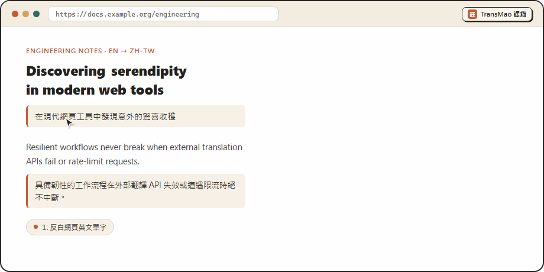

<div align="center">
  

  <br /><br />

  <p>
    <a href="./README.md">繁體中文</a> &nbsp;|&nbsp; <strong>English</strong>
  </p>

  [](https://github.com/SixMao0122/TransMao/actions/workflows/ci.yml)
  [](./LICENSE)
  [](./public/manifest.json)
  [](./tsconfig.json)
  [](./src/offscreen/offscreen.ts)

  <p align="center">
    <strong>TransMao</strong> is a lightweight, resilient English-to-Traditional Chinese (<code>zh-TW</code>) webpage translation and immersive inline dictionary browser extension.<br/>
    Built to eliminate broken native browser translations with a <strong>4-layer automatic failover pipeline</strong>, a <strong>Shadow DOM isolated selection dictionary</strong>, and <strong>offline Hugging Face ultra-small models</strong>.
  </p>
</div>

---

## Live Demo

<div align="center">
  
</div>

---

## Key Features

* **Resilient Full-Page Translation (`EN → zh-TW`)**
  * **Bilingual Side-by-Side Mode**: Inserts warm paper-tinted Traditional Chinese blocks beneath English paragraphs without breaking host page event listeners, plus a **Replace Mode** with one-click restore (`Alt + T`).
  * **Viewport Lazy Translation (`IntersectionObserver`)**: Translates only paragraphs visible in the current viewport first and seamlessly translates additional content as you scroll.
  * **4-Layer Automatic Failover Pipeline**: `Google Clients5 (native multi-query batch)` → `Google GTX RPC` → `MyMemory (5x concurrent fallback)` → `Hugging Face Local Model`, post-processed with `OpenCC (s2twp)` for authentic Taiwan Traditional Chinese vocabulary.
  * **SPA-Aware DOM Watcher (`MutationObserver`)**: Automatically handles dynamically loaded pages while skipping hidden elements, `<code>`, and `<pre>` blocks.
* **Instant Selection Dictionary (POS · Examples · Pronunciation)**
  * Highlight any English word or phrase to reveal a clean seal trigger button (or expand the card immediately).
  * **100% Isolated Shadow DOM UI** in a warm paper & ink stationery design displaying Traditional Chinese definitions, IPA phonetics, color-coded Parts of Speech (`n.`, `v.`, `adj.`, etc.), and highlighted bilingual example sentences.
  * **Dual-Layer Audio Pronunciation**: US and UK pronunciation buttons prioritizing real human dictionary MP3 audio with automatic fallback to the browser's `Web Speech API`.
  * **Saved Vocabulary List**: Bookmark words with one click, replay pronunciations, and export your list to JSON from the Options dashboard.
* **Offline Hugging Face Ultra-Small Models (Local Fallback)**
  * Bundles ONNX Runtime WASM locally inside the extension (100% Chrome MV3 CSP compliant, zero remote CDN script execution) via `Offscreen Document` + `@huggingface/transformers`:

| Hugging Face Model ID | Quantized Size | Notes |
| :--- | :--- | :--- |
| **`Xenova/opus-mt-en-zh`** | ~80 MB | Ultra-lightweight and fast; paired with `opencc-js` (`s2twp`) for `zh-TW` localization |
| **`Xenova/nllb-200-distilled-600M`** | ~350 MB | Meta distilled multilingual NMT model with native `zho_Hant` support |

---

## Quick Start

### Option 1: Install from GitHub Releases (Recommended)
1. Download the latest `trans-mao-v*.zip` from the [Releases](https://github.com/SixMao0122/TransMao/releases) page and unzip it.
2. Open `chrome://extensions/` (Chrome) or `edge://extensions/` (Edge).
3. Enable **Developer mode** in the top-right corner.
4. Click **Load unpacked** and select the extracted folder.

### Option 2: Build from Source
Requires **Node.js `>= 20`**.

```bash
git clone https://github.com/SixMao0122/TransMao.git
cd TransMao
npm install
npm run icons   # Generate 16/32/48/128 PNG extension icons
npm run build   # Build into dist/ (bundles local ORT WASM)
```

Then load the `dist/` directory via **Load unpacked** in your browser's extension page.

---

## Development Scripts

```bash
npm run watch          # Watch source files and rebuild dist/
npm run typecheck      # Strict TypeScript type-checking
npm run test           # Run Vitest unit tests
npm run build:release  # Minified production build (no sourcemaps)
npm run package        # Build and zip release/trans-mao-v0.1.0.zip
```

---

## Security & Privacy

TransMao collects zero telemetry or browsing history. See [SECURITY.md](./SECURITY.md) for privacy details and vulnerability reporting.

---

## Contributing

Issues, feature suggestions, and pull requests are welcome! Please read [CONTRIBUTING.md](./CONTRIBUTING.md) and [CODE_OF_CONDUCT.md](./CODE_OF_CONDUCT.md) first.

---

## License

Licensed under the **[Apache License 2.0](./LICENSE)**.
