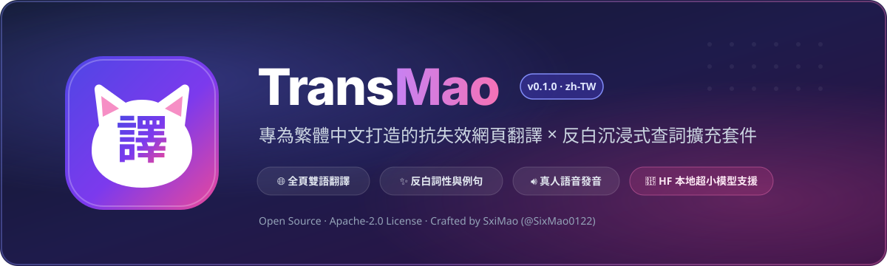
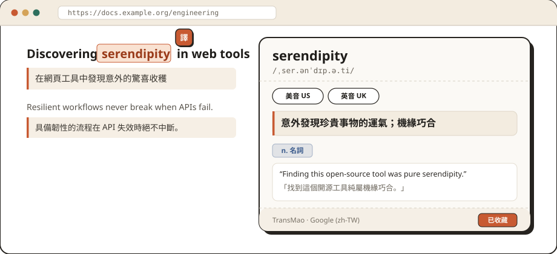
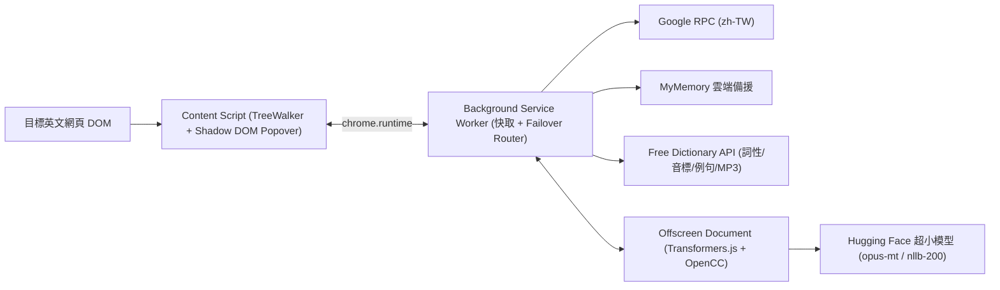

<div align="center">
  

  <br /><br />

  [](./LICENSE)
  [](./public/manifest.json)
  [](./tsconfig.json)
  [](./src/offscreen/offscreen.ts)
  [-10b981?style=for-the-badge)](#)

  <p align="center">
    <strong>TransMao（譯貓）</strong> 是一款專為台灣繁體中文 (<code>zh-TW</code>) 打造的輕量、抗失效網頁翻譯與反白沉浸式查詞瀏覽器擴充套件。<br/>
    告別原生 Google 翻譯動不動失效的痛點，結合 <strong>多引擎自動容錯</strong>、<strong>Shadow DOM 零污染反白詞典</strong> 與 <strong>Hugging Face 本地超小模型</strong>。
  </p>
</div>

---

## ✨ 功能預覽 (Preview)

<div align="center">
  
</div>

---

## 🚀 核心特色

* **🌐 抗失效全頁翻譯（EN → 繁體中文 `zh-TW`）**
  * 支援 **雙語對照模式**（英文段落下以淡色呈現繁中，不破壞網頁原有按鈕事件）與 **純繁體中文替換模式**（一鍵隨時還原原文）。
  * 內建 **多引擎自動容錯 (Failover)**：`Google RPC` → `MyMemory 免費備援` → `Hugging Face 本地模型`，並自動經過 `OpenCC (s2twp)` 轉換為道地台灣繁體中文慣用語（如：軟體、伺服器、記憶體）。
  * 支援 SPA 動態頁面監聽（`MutationObserver`），自動排除 `<code>`、`<pre>` 等程式碼區塊。
* **✨ 反白懸浮詞典（詞性 · 例句 · 真人發音）**
  * 反白網頁任何英文單字或片語，立即浮出輕巧的「**譯**」小圖示（亦可設定直接展開卡片）。
  * 採用 **Shadow DOM 樣式完全隔離**，卡片顯示：**繁中釋義**、**國際音標**、**色彩分類詞性標籤（`n.`、`v.`、`adj.`…）**、**中英雙語例句**。
  * **雙層發音引擎**：提供 **🔊 美音 (US)** 與 **🔊 英音 (UK)** 按鈕，優先播放辭典官方真人 MP3 音檔，受限時自動降級為瀏覽器原生 `Web Speech API`，點了必有聲音。
  * 內建 **★ 個人單字本**：一鍵收藏生詞，並可在設定頁複習朗讀或匯出 JSON。
* **🤗 支援 Hugging Face 本地超小模型（離線終極備援）**
  * 透過 Manifest V3 `Offscreen Document` + `@huggingface/transformers` 在瀏覽器本地推論，無 API 次數上限、斷網也能翻：

| 模型 ID (Hugging Face) | 量化大小 | 特色說明 |
| :--- | :--- | :--- |
| **`Xenova/opus-mt-en-zh`** | ~80 MB | 極輕量、速度最快，自動搭配 `opencc-js` (`s2twp`) 轉為台灣繁體中文 |
| **`Xenova/nllb-200-distilled-600M`** | ~350 MB | Meta 多語蒸餾翻譯模型，原生支援 `zho_Hant` 繁體中文 |

---

## 🏗️ 系統架構 (Architecture)



---

## 📦 快速開始與本地安裝 (Quick Start)

### 1. 環境需求
* Node.js `>= 20`
* Chrome / Edge / Brave 等 Chromium 核心瀏覽器

### 2. 安裝依賴並建置
```bash
git clone <your-repo-url>
cd TransMao
npm install
npm run icons   # 產生 16/32/48/128 PNG 擴充套件圖示
npm run build   # 建置至 dist/
```

### 3. 載入至瀏覽器
1. 開啟瀏覽器並前往擴充功能管理頁面：
   * Chrome：`chrome://extensions/`
   * Edge：`edge://extensions/`
2. 開啟右上角的 **「開發人員模式 (Developer mode)」**。
3. 點擊 **「載入未封裝項目 (Load unpacked)」**，選擇本專案的 **`dist/`** 資料夾。
4. 將 **TransMao 譯貓** 釘選至工具列，前往任意英文網頁即可開始體驗！

---

## 🧪 開發指令

```bash
npm run watch      # 監聽變更並自動重新編譯 dist/
npm run typecheck  # TypeScript 嚴格型別檢查
npm run test       # 執行 Vitest 單元測試
```

---

## 🛡️ 安全性與隱私 (Security & Privacy)

TransMao 尊重使用者隱私，不收集任何個人瀏覽紀錄或遙測資料。詳細資訊與漏洞回報管道請參閱 [SECURITY.md](./SECURITY.md)。

---

## 🤝 參與貢獻 (Contributing)

非常歡迎提出 Issue、功能建議或 Pull Request！請先閱讀 [CONTRIBUTING.md](./CONTRIBUTING.md) 與 [CODE_OF_CONDUCT.md](./CODE_OF_CONDUCT.md)。

---

## 📄 授權條款 (License)

本專案採用 **[Apache License 2.0](./LICENSE)** 開源授權。  
Copyright © 2026 **SxiMao** ([@SixMao0122](https://github.com/SixMao0122)).
